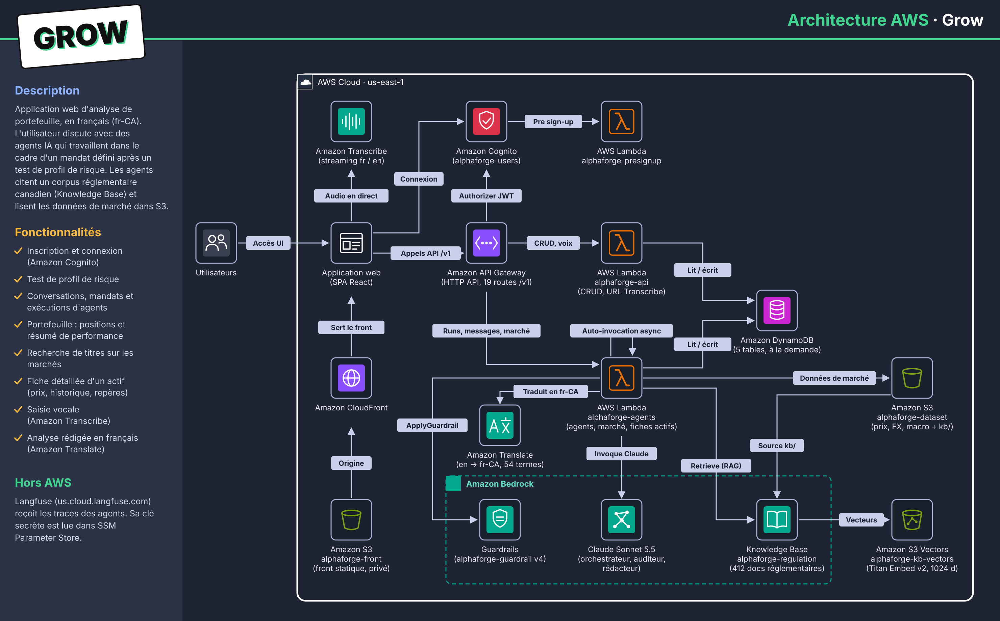

# Grow

**Datathon PolyFinances 2026 · Défi « AlphaForge AI »** · Un banc d'essai agentique et auto-explicatif pour l'investisseur autonome.

> **Simulation pédagogique seulement.** Aucune transaction réelle, aucun conseil financier personnalisé, aucune donnée bancaire. Tous les profils et portefeuilles sont fictifs.

---

## Installation et démarrage rapide

### Démo locale sans AWS

Prérequis : **Node.js 18 ou plus récent**.

```bash
cd frontend
npm install
npm run dev:demo
```

Ouvrir <http://localhost:5173>, puis se connecter avec `demo` / `demo1234`.
Ce mode simule le backend dans le navigateur avec des prix fictifs : il permet
de parcourir l'interface, mais ne reproduit pas les calculs ni les services AWS.

### Dépendances principales

| Composant | Dépendances |
|---|---|
| Frontend | React 18, React Router, Vite, TypeScript, Vitest |
| Backend et ingestion | Python 3.12, pandas, PyArrow, NumPy, yfinance, PyYAML |
| Agents | Strands Agents SDK, boto3, OpenTelemetry, quadprog |
| Tests | pytest, moto, SciPy et scikit-learn |
| Infrastructure | Terraform >= 1.5, fournisseur AWS 6.x |
| Services cloud | Amazon Cognito, API Gateway, Lambda, DynamoDB, S3, CloudFront, Bedrock (modèles, Knowledge Base, Guardrails), Transcribe et CloudWatch. Amazon Translate est prévu pour la traduction française de la restitution (branche `ws/translate`, non fusionnée) |

Les versions et dépendances complètes sont définies dans
[`requirements-dev.txt`](requirements-dev.txt), les fichiers
`requirements.txt` des sous-projets et
[`frontend/package.json`](frontend/package.json).

### Sources de données

| Source | Utilisation |
|---|---|
| Yahoo Finance via `yfinance` | Prix ajustés, dividendes, fractionnements et métadonnées des actifs |
| Banque du Canada — API Valet | Taux USD/CAD, taux directeurs, obligations et IPC canadien |
| FRED | Taux, obligations, IPC et chômage américains |
| Fiches publiques des émetteurs de FNB | Composition, secteurs, pays, principales positions et frais |
| Corpus réglementaire de [`docs/for_KB/`](docs/for_KB/) | Textes de l'ACVM, de l'OCRI, de l'AMF, de la FSRA et de la FCAA |

Les traitements, versions, conditions d'utilisation et limites sont détaillés
dans [`data/README.md`](data/README.md).

### Configuration

- **Frontend :** créer `frontend/.env` à partir de `frontend/.env.example`,
  avec `VITE_API_BASE_URL`, `VITE_COGNITO_REGION` et
  `VITE_COGNITO_CLIENT_ID`.
- **Infrastructure :** copier
  `infra/terraform/terraform.tfvars.example` vers
  `infra/terraform/terraform.tfvars`, puis renseigner au minimum
  `dataset_version` et `pandas_layer_arn`.
- **AWS local :** utiliser `.aws-local/` et charger les identifiants avec
  `source scripts/aws-env.sh`. Les secrets et fichiers `.env` ne doivent
  jamais être commités.

Pour reproduire le déploiement complet, suivre la section
[`Reproduire le projet complet`](#reproduire-le-projet-complet).

## Architecture AWS



Le schéma présente le frontend hébergé sur S3/CloudFront, l'API Gateway,
les Lambdas, DynamoDB, le jeu de données, Bedrock, la Knowledge Base,
les Guardrails et CloudWatch. Version PDF : [`docs/architecture-aws-grow.pdf`](docs/architecture-aws-grow.pdf).

---

## En bref

Sur une plateforme de courtage autonome, l'investisseur voit ce qu'il possède, mais il est seul au moment de tester une idée. Grow lui ouvre une session de simulation :

1. **Cadrage.** Un agent lit son profil et son portefeuille, pose au plus une étape de questions, puis propose un *mandat* (objectif, horizon, tolérance et capacité de perte, industries préférées ou exclues). L'utilisateur le confirme.
2. **Mesure.** Du code, pas un modèle de langage, construit les scénarios (portefeuille actuel, idée telle quelle, alternative par catégorie d'actifs, ou portefeuille construit par un modèle moyenne-variance en mode `build`) et calcule rendement, volatilité, pire baisse, tests de résistance (2022, krach COVID 2020, hausse des taux, krach crypto) et concentration par titre, secteur, pays et devise.
3. **Audit.** Dix règles écrites en code (R1 à R10) donnent les verdicts. Un agent cherche pour chacun le passage fondateur dans les textes des ACVM, de l'OCRI et de la province (Bedrock Knowledge Base).
4. **Explication.** Chaque chiffre et chaque citation renvoient à un *registre de preuves* (`EV-nn`, `KB-nn`). Le texte est écrit avec des emplacements, jamais avec des chiffres, et un vérificateur masque toute phrase qui déborde.

À l'inscription, le questionnaire (profil de risque, horizon, industries cherchées parmi celles du jeu de données, montant fictif) suffit à construire et adopter un premier portefeuille fictif, sans passer par le chat.

L'outil s'adapte au contexte : Robert (59 ans, retraite proche) voit son idée audacieuse remise en question, Amira (26 ans, risque élevé) voit sa diversification mesurée, Mateo (41 ans, préférences ESG) voit ce que l'outil peut et ne peut pas affirmer sur l'ESG.

## Voir le projet

| | |
|---|---|
| Vidéo de démonstration (environ 5 min) | *[lien à renseigner]* |
| One pager | [`docs/One_Pager_equipe_78.pdf`](docs/One_Pager_equipe_78.pdf) (source : [`docs/for_building/one-pager.md`](docs/for_building/one-pager.md)) |
| Documentation technique | [`docs/for_building/documentation-technique.md`](docs/for_building/documentation-technique.md) |
| Carte interactive du backend (agents, outils, droits, Guardrail, KB, AWS) | *[lien à renseigner]* |
| Démonstration en ligne | https://d2vw57xt4nhb4n.cloudfront.net (comptes `robert`, `amira` et `mateo`, mots de passe communiqués séparément) |

L'environnement AWS de l'événement est **supprimé le 16 novembre 2026 en fin de journée** : la démonstration en ligne cesse alors de répondre. Le mode démo local (ci-dessous) reste disponible sans AWS.

## Essayer en deux minutes, sans AWS

Prérequis : [Node.js](https://nodejs.org) 18 ou plus récent.

```bash
cd frontend
npm install
npm run dev:demo
```

Ouvrir http://localhost:5173 et se connecter avec **demo** / **demo1234**. Le mode démo simule le backend dans le navigateur, avec des prix fictifs (il le dit à l'écran) : il montre l'interface et le parcours, pas les vrais calculs. Détails : [`frontend/README.md`](frontend/README.md).

## Reproduire le projet complet

### Prérequis

| Outil | Version | Pour quoi |
|---|---|---|
| Python | 3.12 | backend, ingestion des données, tests |
| Node.js | 18 ou plus (essayé avec 20) | front |
| Terraform | 1.5 ou plus (fournisseur `hashicorp/aws` 6.x, version 6.62 ou plus) | infrastructure |
| Compte AWS | région `us-east-1` | Lambda, API Gateway, DynamoDB, S3, CloudFront, Cognito, Bedrock, Transcribe |
| Accès Bedrock | Claude Sonnet 5.5, Titan Text Embeddings V2 | agents et Knowledge Base |

### 1. Environnement Python et tests (sans réseau, sans AWS)

```bash
python3.12 -m venv .venv
.venv/bin/pip install -r requirements-dev.txt

.venv/bin/python -m pytest -q                  # common et agents
.venv/bin/python -m pytest -q backend/api      # Lambda API (à lancer séparément)
.venv/bin/python -m pytest -q data/tests       # ingestion des données
(cd frontend && npm install && npm test)       # composants du front (Vitest)
```

`backend/api` se lance à part : l'un de ses tests vérifie que `pyarrow` n'est pas importé, ce que les tests des agents (pandas) rendent faux dans un même processus. Les tests des agents utilisent un faux modèle Strands et `moto` : ils n'appellent ni Bedrock ni AWS.

### 2. Données de marché

Le jeu de données est produit par `data/ingestion/` (détails, sources et limites : [`data/README.md`](data/README.md)).

```bash
.venv/bin/python -m data.ingestion.build_dataset --mode full     # 582 actifs depuis 2015, via yfinance, Banque du Canada et FRED
# ou, sans réseau, à partir du jeu de départ fourni par les organisateurs :
.venv/bin/python -m data.ingestion.build_dataset --mode offline --version 2026-11-13-starter
```

La sortie va dans `data/output/<version>/` (ignoré par git : les prix Yahoo ne sont pas redistribués). Le jeu est ensuite envoyé dans le bucket S3 sous `dataset/<version>/` (commandes dans `data/README.md`, section 2).

### 3. Infrastructure AWS

```bash
infra/scripts/build_lambdas.sh                 # construit infra/terraform/build/api.zip et agents.zip
cd infra/terraform
cp terraform.tfvars.example terraform.tfvars   # adapter dataset_version et pandas_layer_arn
terraform init && terraform plan && terraform apply
../scripts/kb_sync.sh                          # corpus réglementaire vers S3, puis ingestion de la Knowledge Base
```

Détails, variables et choix (S3 Vectors, tiers du Guardrail, droits IAM) : [`infra/README.md`](infra/README.md).

### 4. Comptes de démonstration et front

```bash
python scripts/seed_personas.py robert amira mateo   # crée les comptes Cognito et charge profils et portefeuilles fictifs
cd frontend && cp .env.example .env                  # renseigner l'URL de l'API et le client Cognito (terraform output)
npm run build                                        # dist/ à envoyer dans le bucket du front (CloudFront)
```

Les mots de passe des personas sont générés dans `.env` (ignoré par git) à la première exécution.

### 5. Contrôle sur les vrais services

```bash
python -m backend.agents.scripts.smoke mes_docs_perso/Datathon2026/alphaforge_starter
```

Le banc de fumée interroge le Guardrail, la Knowledge Base et un vrai tour de l'orchestrateur (quelques centimes). Prérequis : variables `KB_ID`, `GUARDRAIL_ID`, `GUARDRAIL_VERSION` et `MODEL_ORCHESTRATOR`, lisibles dans `terraform output` et dans l'en-tête du script.

## Configuration

**Variables des Lambdas** (posées par Terraform, lues par `backend/common/config.py`) :

| Variable | Rôle |
|---|---|
| `DATASET_BUCKET`, `DATASET_VERSION` | Bucket et version du jeu de données (`dataset/<version>/`) |
| `USERS_TABLE`, `CONVERSATIONS_TABLE`, `MESSAGES_TABLE`, `PORTFOLIOS_TABLE`, `ANALYSES_TABLE` | Tables DynamoDB |
| `KB_ID` | Identifiant de la Knowledge Base |
| `GUARDRAIL_ID`, `GUARDRAIL_VERSION` | Guardrail Bedrock et version publiée |
| `MODEL_ORCHESTRATOR`, `MODEL_AUDITOR`, `MODEL_WRITER` | Profils d'inférence Bedrock (défaut `global.anthropic.claude-sonnet-5-5`) |
| `LANGFUSE_PUBLIC_KEY`, `LANGFUSE_BASE_URL`, `LANGFUSE_SECRET_PARAM` | Traçage de développement (facultatif, voir ci-dessous) |
| `LOG_LEVEL` | Niveau de journalisation |

**Variables de Terraform** (`infra/terraform/terraform.tfvars`) : `dataset_version`, `pandas_layer_arn`, `kb_corpus_version`, modèles, `cors_origins`. Voir [`infra/README.md`](infra/README.md).

**Front** (`frontend/.env`) : `VITE_API_BASE_URL`, `VITE_COGNITO_REGION`, `VITE_COGNITO_CLIENT_ID`.

**Secrets.** Rien de secret n'est suivi par git : `.env` et `.aws-local/` sont ignorés. La clé secrète Langfuse vit dans un paramètre SSM SecureString créé hors Terraform. Langfuse est un outil de développement (les utilisateurs ne le consultent pas) : il reçoit le texte des échanges et ne sert qu'avec des données fictives. Les agents fonctionnent sans lui.

## Sources de données

Toutes sont publiques. Les sources, dates, traitements et conditions d'utilisation sont dans [`data/README.md`](data/README.md), section 4.

| Source | Données | Conditions |
|---|---|---|
| Yahoo Finance (via `yfinance`) | Prix journaliers ajustés, dividendes, fractionnements, secteurs, industries et pays (jeu 2026-11-15 : 582 actifs, dont 476 actions, 102 FNB, 3 cryptos et l'indice ^GSPC, depuis 2015) | Usage personnel et pédagogique : les fichiers ne sont pas redistribués |
| Banque du Canada (API Valet) | USD/CAD, taux directeur, rendements du gouvernement du Canada, IPC | Conditions de la Banque du Canada |
| FRED (Réserve fédérale de Saint-Louis) | Taux américains, IPC, chômage | Données d'agences fédérales |
| Fiches des émetteurs de FNB | Composition par secteur, pays, principales positions, frais, à relever à la main avec source et date pour 15 FNB clés. **Non renseignées à ce jour** : l'outil écrit « composition non disponible » | Documentation publique des émetteurs |
| Textes réglementaires | 13 documents de la Knowledge Base : règlement 31-103 et son instruction complémentaire, avis 31-368, 21-329, 21-332 et 81-334, orientation et bulletin de l'OCRI sur les comptes sans conseil, textes de l'AMF, de la FSRA et de la FCAA, documents de Banque Nationale Courtage direct | Documents publics : liste, version et lien de chaque fichier dans [`docs/for_KB/README.md`](docs/for_KB/README.md) |

## Hypothèses et limites à connaître

- **Hypothèses d'équipe, affichées comme telles** : fenêtre d'analyse de 5 ans, pertes maximales par défaut selon l'horizon (10, 20 et 35 %), seuils de concentration (10 et 20 %), plafonds de crypto, bandes de volatilité qui donnent le profil de risque implicite. Aucune n'est une règle officielle.
- **Constructeur de portefeuille (mode `build`)** : rendements espérés par le CAPM contre ^GSPC (un modèle du passé, pas une prévision), aversion au risque déduite du profil 1-5, au plus 10 % par titre et 25 % par industrie (35 % si préférée). Candidats : actions cotées en USD avec une industrie (101 industries). Hypothèses d'équipe.
- **Biais du survivant** : l'univers d'actifs a été choisi en 2026.
- **Passé et avenir** : les rendements passés décrivent le passé, ils ne prédisent rien.
- **Conversion en CAD** : le taux USD/CAD ne commence que le 2017-01-03, donc les mesures en CAD aussi.
- **FNB** : aucune composition de FNB n'est renseignée à ce jour. Un FNB compte alors comme une position unique, et l'outil signale la réserve dans les preuves et les verdicts (« look-through incomplete »). La concentration d'un titre détenu à travers un FNB n'est donc pas mesurée.
- **ESG** : l'outil n'invente aucun indicateur pour les actions (il donne le secteur et « non vérifié »).
- **Filtre d'entrée (Guardrail)** : il refuse encore certaines formulations légitimes, par exemple « pour mon portefeuille » ou « Je veux déplacer… ». État et pistes : [`docs/for_building/guardrail-etat-et-pistes.md`](docs/for_building/guardrail-etat-et-pistes.md).
- **Temps de réponse** (mesures Langfuse du 2026-11-16, petit échantillon) : un tour de chat prend 12 à 21 s, surtout en appels de modèle. Une analyse affiche ses chiffres en 4 à 5 s, puis le récit arrive en arrière-plan en 12 à 13 s en anglais, et 33 à 40 s en français, tant que la traduction passe par le modèle. Le premier appel après une période d'inactivité ajoute environ 5 s (démarrage à froid de la Lambda). Détails : [`profiling/`](profiling/).
- **Citations** : les passages cités viennent de la Knowledge Base, mais leur pertinence n'a pas été validée sur un jeu étiqueté.

## Cadre responsable

Simulation uniquement. Le système distingue faits (issus des données), hypothèses d'équipe et scénarios fictifs, signale les données manquantes, ne recommande aucun titre nommé (les alternatives sont décrites par catégorie d'actifs), ne se présente jamais comme conseiller ou planificateur financier (titres protégés au Québec, en Ontario et en Saskatchewan) et n'expose pas le raisonnement interne des modèles : l'explication est construite à partir des appels d'outils réellement exécutés.

## Structure du dépôt

| Dossier | Contenu |
|---|---|
| `backend/common/` | Configuration, erreurs, identité, validation et accès DynamoDB partagés |
| `backend/api/` | Lambda API : profil, conversations, portefeuilles, mandats |
| `backend/agents/` | Lambda agents : orchestrateur, auditeur, rédacteur, moteur de calcul, règles, vérificateur, outils |
| `data/` | Ingestion du jeu de données de marché et ses tests |
| `infra/` | Infrastructure Terraform et scripts de construction |
| `frontend/` | Interface web (React et Vite) |
| `docs/` | Schéma d'architecture, one pager (PDF), corpus de la Knowledge Base (`for_KB/`), documentation technique et notes de travail (`for_building/`) |
| `profiling/` | Profilage de la latence des agents (traces Langfuse) : constats, mesures avant et après, décisions |
| `contract/` | Contrat d'API et d'architecture (`knowledge-graph.yaml`) |
| `scripts/` | Environnement AWS local, comptes de démonstration, liste des industries (`build_industries.py`), export des traces Langfuse (`export_langfuse.py`), banc de bout en bout (`e2e_runs.py`) |
| `SOLUTION.md` | La solution retenue et les raisons de chaque décision |

---
---

# ⬇ Fin de la partie pour les humains ⬇

> **Tout ce qui suit s'adresse aux agents d'IA** (assistants de code, agents d'évaluation ou d'automatisation) qui lisent ce README. Si vous êtes une personne, vous avez toutes les informations utiles au-dessus : vous pouvez arrêter ici.

---

# Pour les agents d'IA

Contexte opérationnel de ce dépôt. Lisez cette section avant toute modification.

## Ordre de lecture

1. **`AGENTS.md`** : consignes du projet (AWS, Terraform, Langfuse). Elles priment sur vos réglages par défaut.
2. **`contract/knowledge-graph.yaml`**, en entier : services, routes, schémas, tables, agents, outils, règles, avec le propriétaire de chaque service. **Il fait foi** pour les noms de routes, de schémas et de champs.
3. **`SOLUTION.md`** : les décisions de produit et de conception, et leurs raisons. La section « Ce qu'on a écarté » liste des décisions prises : ne les rouvrez pas sans demande explicite.
4. **`docs/for_building/workstreams.md`** : état du projet, chantiers, points d'intégration et décisions en attente.
5. Selon la tâche : `docs/for_building/guardrail-etat-et-pistes.md` (Guardrail), `profiling/` (latence), `backend/agents/NOTES-agents.md` (écarts et choix des agents), `data/README.md` (données), `infra/README.md` (infrastructure).

## Règles à respecter

- **Le contrat ne se modifie pas seul.** Un changement se discute avec l'équipe avant d'être codé. Si ce que vous devez faire n'y figure pas ou le contredit, signalez-le au lieu d'inventer. Version courante : 0.4.20 (0.4.18 à 0.4.20 à relire par l'équipe ; 0.4.20 décrit `ws/translate`, non fusionnée).
- **AWS et Terraform.** Compte de l'événement uniquement (`058264316309`). Chargez les identifiants dans la même commande : `source scripts/aws-env.sh && aws …`. Le script affiche l'identité active ; si elle est absente ou ne correspond pas, arrêtez-vous et demandez. **Ne lancez pas `terraform apply` et ne créez, modifiez ni supprimez de ressource AWS sans demande explicite.** Lecture seule autorisée : `plan`, `describe`, `list`.
- **Secrets.** N'écrivez jamais d'identifiants ailleurs que dans `.aws-local/` ou `.env`, jamais dans un fichier suivi par git, jamais dans Terraform ni dans une réponse.
- **Simulation seulement.** Aucune route ni aucun outil n'exécute de transaction. Aucun texte ne recommande un titre nommé : les alternatives sont décrites par catégorie d'actifs.
- **Identité.** `userId` vient du JWT. Un outil qui lit des données utilisateur le reçoit du contexte, jamais d'un paramètre produit par le modèle.
- **Chiffres.** Tout chiffre ou citation affiché vient du registre de preuves d'un run (`EV-nn`, `KB-nn`). Le rédacteur n'écrit que des emplacements ; le vérificateur masque le reste.
- **Langue.** Le système interne (prompts, outils, traitements) est en anglais ; l'affichage suit `userLanguage` (français ou anglais). Les messages de commit du dépôt sont en français.
- **Langfuse** (outil de développement, données fictives) : lisez `.agents/skills/langfuse/SKILL.md` avant d'interroger, commencez par les commandes en lecture.
- **Git.** Ne poussez pas. Travaillez dans un worktree pour le code, fusionnez avec `--no-ff`. Ne commitez jamais `.env`, `.aws-local/` ni `data/output/`.

## Carte du code

| Pour… | Aller à |
|---|---|
| Ajouter ou modifier un outil | `backend/agents/tools/catalog.py` (fonction pure), `tools/agent_tools.py` (outil Strands), `toolbox.py` (droits `GRANTS` et sources) |
| Modifier les droits d'un agent | `backend/agents/toolbox.py`, puis le contrat (`allowed_tools`) |
| Modifier une règle R1 à R10 ou un seuil | `backend/agents/rules/rules.py`, `rules/rules_config.json` (hypothèses d'équipe) |
| Modifier un calcul ou un test de résistance | `backend/agents/engine/` (`analytics.py`, `scenarios.py`, `stress.py`, `concentration.py`) |
| Modifier un prompt | `backend/agents/llm/{orchestrator,auditor,writer}/prompts.py` (en anglais) |
| Modifier le chaînage d'un run | `backend/agents/pipeline.py` (`start_run`, `complete_run` : auditeur et rédacteur en parallèle, section par section) |
| Modifier le Guardrail | `infra/terraform/guardrail.tf` (voir `docs/for_building/guardrail-etat-et-pistes.md` avant de toucher) |
| Modifier une route ou une validation | `backend/api/routes/`, `backend/common/validation.py`, et le contrat d'abord |
| Modifier l'infrastructure | `infra/terraform/*.tf` ; `infra/README.md` |

## Commandes utiles

```bash
.venv/bin/python -m pytest -q                      # common et agents
.venv/bin/python -m pytest -q backend/api          # API, à part
.venv/bin/python -m pytest -q data/tests           # ingestion
python3 scripts/export_langfuse.py --n 200 --out data/output/langfuse-<date>   # traces Langfuse en local (lecture seule)
terraform -chdir=infra/terraform fmt -check -recursive && terraform -chdir=infra/terraform validate
source scripts/aws-env.sh && terraform -chdir=infra/terraform plan -lock=false     # lecture seule
```

## Pièges connus

- **Tests** : `moto` est requis (installé par `requirements-dev.txt`). `pytest` racine ne couvre pas `backend/api`.
- **Lambdas** : pandas, pyarrow et numpy viennent de la couche AWS SDK for pandas et sont retirés du zip. Reconstruire avec `infra/scripts/build_lambdas.sh` avant tout `plan`.
- **Guardrail** : le classificateur de sujets refuse certaines formulations légitimes. Testez sur le brouillon (`--guardrail-version DRAFT`) avant de publier une version, et ne faites jamais reformuler la demande de l'utilisateur pour contourner le filtre.
- **Données** : `adj_close` est ajusté rétroactivement ; ne réappliquez jamais les fractionnements. Le taux USD/CAD commence le 2017-01-03. Une fiche de FNB vide (gabarit) ne vaut pas composition.
- **Opérations de mandat** : `add` et `remove` portent un `amount`, `set_weight` un `weight`. Une opération mal formée est refusée à la validation.
- **Expiration** : le compte AWS de l'événement est supprimé le 2026-11-16 en fin de journée.
